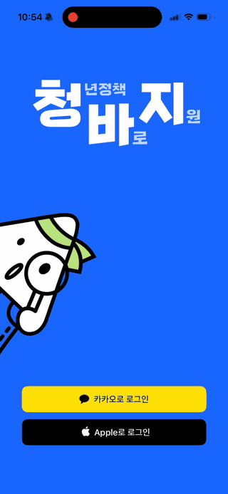
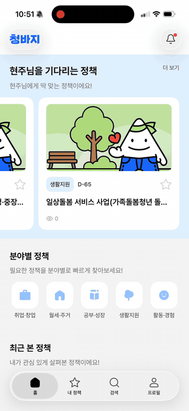
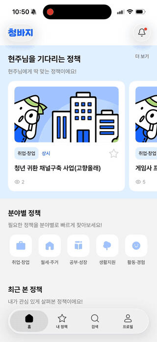
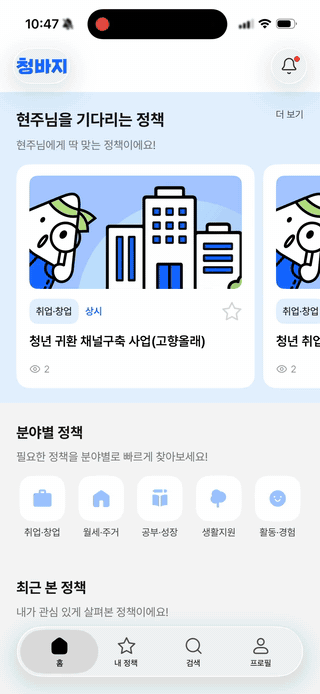
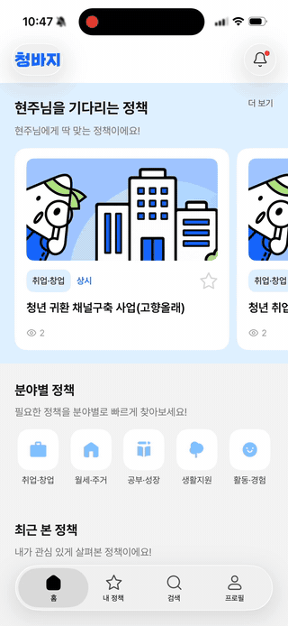
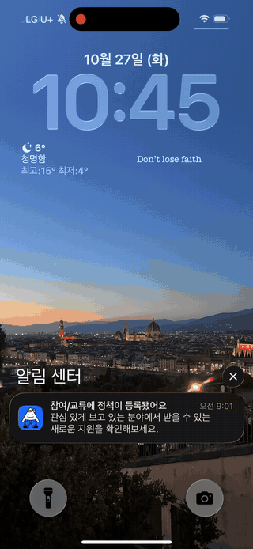
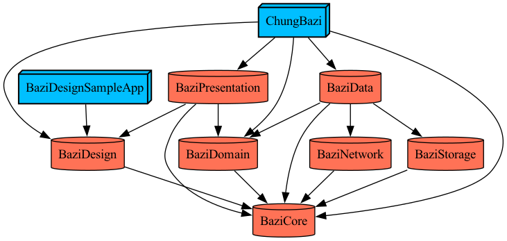

# 👖 청바지 (ChungBazi)

> 나에게 맞는 청년 지원 정책을 쉽고 빠르게 추천받고, 신청까지 간편하게.

청바지는 흩어져 있는 청년 지원 정책을 한곳에서 살펴보고, 내 조건에 맞는 정책을 찾을 수 있도록 돕는 iOS 앱입니다.

<p align="center">
  
</p>

<p>
  <a href="https://www.swift.org"></a>
  <a href="https://developer.apple.com/xcode/swiftui/"></a>
  <a href="https://developer.apple.com/ios/ios-17/">
    
  </a>
  <a href="https://github.com/pointfreeco/swift-composable-architecture"></a>
  <a href="https://tuist.dev"></a>
  <a href="LICENSE"></a>
</p>

<a href="https://apps.apple.com/kr/app/%EC%B2%AD%EB%B0%94%EC%A7%80-%EC%B2%AD%EB%85%84%EC%A0%95%EC%B1%85-%EB%B0%94%EB%A1%9C-%EC%A7%80%EC%9B%90/id6753987371">
  
</a>

## 🗓️ 개발 기간

| 버전 | 개발 기간 |
| --- | --- |
| V1 | 2025.01 – 2026.02 |
| V2 | 2026.06 – 진행 중 |

## ✨ 주요 기능

- **맞춤 정책 추천** — 나이와 지역, 학력·취업 상태, 소득과 관심 분야를 바탕으로 나에게 맞는 정책 추천
- **정책 탐색과 검색** — 분야별·인기·신규·마감 임박 정책을 살펴보고, 필요한 정책은 키워드로 검색
- **신청 정보와 바로가기** — 지원 자격과 신청 방법, 제출 서류를 먼저 확인하고 신청 페이지로 바로 이동
- **정책 내용 요약** — 긴 지원 내용의 핵심을 쉽게 파악. iOS 26 이상 Apple Intelligence 지원 기기에서는 온디바이스 AI 요약 제공
- **관심 정책 관리** — 마음에 드는 정책을 찜하고, 마감 임박 정책을 확인하거나 메모·캘린더로 일정을 관리
- **알림** — 새로운 맞춤 정책과 찜한 정책의 변경·마감 소식 확인

### 기능 미리보기

<table>
  <tr>
    <th>맞춤 정책 추천</th>
    <th>정책 탐색과 검색</th>
    <th>신청 정보와 바로가기</th>
  </tr>
  <tr>
    <td align="center">
      <br>
      <sub>나이·지역 등 조건을 바탕으로 나에게 맞는 정책 추천</sub>
    </td>
    <td align="center">
      <br>
      <sub>분야별 정책 탐색과 키워드 검색</sub>
    </td>
    <td align="center">
      <br>
      <sub>지원 자격·신청 방법·제출 서류 확인 후 신청 페이지로 이동</sub>
    </td>
  </tr>
  <tr>
    <th>정책 내용 요약</th>
    <th>관심 정책 관리</th>
    <th>알림</th>
  </tr>
  <tr>
    <td align="center">
      <br>
      <sub>지원 내용 핵심 요약 · 지원 기기에서 온디바이스 AI 제공</sub>
    </td>
    <td align="center">
      <br>
      <sub>관심 정책과 마감 임박 정책 확인, 메모·캘린더로 일정 관리</sub>
    </td>
    <td align="center">
      <br>
      <sub>맞춤 정책과 찜한 정책의 변경·마감 알림</sub>
    </td>
  </tr>
</table>

## 🛠️ 기술 스택

- **앱:** Swift, SwiftUI, iOS
- **아키텍처·빌드:** 클린 아키텍처 기반 멀티 모듈, The Composable Architecture (TCA), Tuist, Swift Package Manager
- **네트워크:** Moya (Alamofire 간접 의존성)
- **로그인·공유:** Sign in with Apple, Kakao SDK
- **Apple 프레임워크:** Keychain Services, EventKit, Foundation Models (Apple Intelligence)
- **분석·운영:** Amplitude, Firebase Cloud Messaging, Crashlytics, Remote Config
- **테스트:** Swift Testing

## 🏗️ 프로젝트 구조

| 모듈 | 역할 |
| --- | --- |
| `ChungBazi` | 앱 진입점, SDK 초기화, 앱 전체 의존성 조립 |
| `BaziPresentation` | SwiftUI 화면, TCA Feature·Reducer, 탭과 화면 이동 |
| `BaziDomain` | 정책·사용자 모델, 유스케이스, 저장소·서비스 인터페이스 |
| `BaziData` | 저장소·외부 서비스 구현, API DTO 매핑과 데이터 캐시 |
| `BaziNetwork` | Moya API·DTO, 공통 요청 처리와 인증 토큰 갱신 |
| `BaziStorage` | Keychain 토큰과 UserDefaults 기반 로컬 설정·세션 상태 |
| `BaziDesign` | 색상·폰트·이미지 디자인 토큰, 공통 SwiftUI 컴포넌트 |
| `BaziCore` | 토큰 저장 추상화, 네트워크 오류·로깅, 앱·캘린더·버전 유틸리티 |

<p align="center">
  
</p>

### 폴더 구조

```text
Projects/
├── ChungBazi/
│   ├── Sources/
│   │   └── Dependencies/
│   ├── Resources/
│   └── SupportingFiles/
├── BaziPresentation/
│   ├── Sources/
│   │   ├── Features/
│   │   │   ├── Auth/
│   │   │   ├── Home/
│   │   │   ├── Main/
│   │   │   ├── MyPolicy/
│   │   │   ├── Onboarding/
│   │   │   ├── PolicyDetail/
│   │   │   ├── Profile/
│   │   │   ├── Search/
│   │   │   └── Splash/
│   │   ├── Dependencies/
│   │   ├── Models/
│   │   ├── Components/
│   │   └── Analytics/
│   ├── RouteReference/
│   └── Tests/
├── BaziDomain/
│   ├── Sources/
│   │   ├── Entity/
│   │   ├── Repository/Interface/
│   │   ├── Service/Interface/
│   │   ├── Usecase/
│   │   └── UsecaseImpl/
│   └── Tests/
├── BaziData/
│   ├── Sources/
│   │   ├── RepositoryImpl/
│   │   ├── Mapper/
│   │   ├── ServiceImpl/
│   │   └── Cache/
│   └── Tests/
├── BaziNetwork/
│   ├── Sources/
│   │   ├── Base/
│   │   ├── Auth/
│   │   ├── Home/
│   │   ├── PolicyDetail/
│   │   ├── PolicySearch/
│   │   └── Session/
│   └── Tests/
├── BaziStorage/
│   ├── Sources/
│   │   ├── Keychain/
│   │   ├── Session/
│   │   └── UserDefaults/
│   └── Tests/
├── BaziDesign/
│   ├── Sources/
│   │   ├── Components/
│   │   ├── Extensions/
│   │   └── Foundation/
│   ├── Resources/
│   ├── SampleApp/
│   └── Tests/
└── BaziCore/
    ├── Sources/
    │   ├── Error/
    │   ├── Logger/
    │   ├── Storage/
    │   └── Util/
    └── Tests/
```

## 🚀 개발 환경 설정

이 프로젝트는 Tuist로 Xcode 프로젝트를 생성합니다. 서버 주소와 외부 서비스 키가 필요하므로, 실행 전 환경 설정 문서를 확인해 주세요.

```sh
./setup.sh
# Configurations에 개발용 설정과 Firebase 설정을 채운 뒤
mise exec -- tuist generate
```

환경 변수, Firebase 설정, 인증서 등 자세한 절차는 [개발 환경 설정 문서](docs/ENVIRONMENT_GUIDELINES.md)를 참고하세요.

## 📚 문서

- [개발 환경 설정](docs/ENVIRONMENT_GUIDELINES.md)
- [코딩 가이드](docs/CODING_GUIDELINES.md)
- [TCA 가이드](docs/TCA_GUIDELINES.md)
- [Git 브랜치와 릴리즈 가이드](docs/GIT_FLOW_GUIDELINES.md)

## 👥 팀원

| 이름 | 프로필 | GitHub |
| --- | --- | --- |
| Hyeon-Ju Lee | <a href="https://github.com/dlguszoo"></a> | [@dlguszoo](https://github.com/dlguszoo) |

## 📄 라이선스

이 프로젝트는 [MIT License](LICENSE)를 따릅니다.
